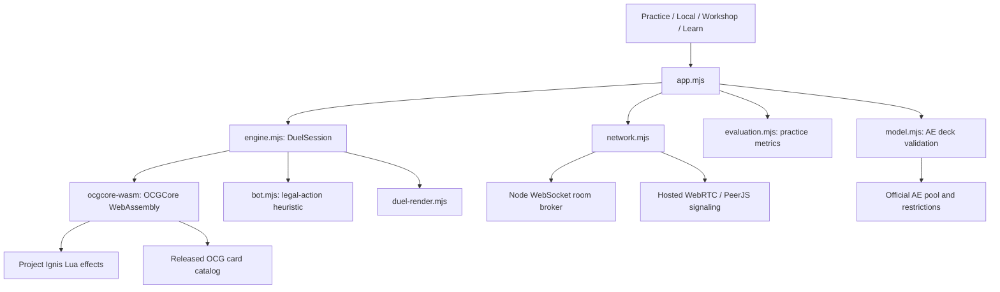

# Architecture and implementation notes

## System shape

The app is a static JavaScript front end with a browser-local WebAssembly duel engine. A small Node server supplies static files and LAN WebSocket rooms. The same browser files can be hosted statically; that environment uses a direct WebRTC connection for rooms instead.

There is no database, authentication service, or paid AI API. Decks live in browser local storage. Room data and active duels are ephemeral. The host browser owns the engine in a local match; this is a trusted personal-practice arrangement, not an anti-cheat architecture for public competitive play.

## Source layout

| File or directory | Responsibility |
| --- | --- |
| `dist/index.html` | Game-screen structure, workshop, tour, accessible dialogs |
| `dist/style.css` | Custom dark teal duel mat, responsive table, cards, chains, reduced-motion styling |
| `dist/app.mjs` | Mode state, decks, practice lifecycle, room messages, UI wiring |
| `dist/model.mjs` | Deck parsing/export, AE validation, zone masks, hidden-information projection |
| `dist/data.mjs` | Bundled data loading, card text, effect descriptions, script archive decoding |
| `dist/engine.mjs` | WebAssembly initialization, seeded opening shuffle, engine stepping, queries, decisions, logs |
| `dist/choices.mjs` | Convert engine decision messages into UI choices and typed engine responses |
| `dist/bot.mjs` | AI action ranking and bounded material-selection search |
| `dist/duel-render.mjs` | Table, zones, hands, card inspection, decisions, logs, and review presentation |
| `dist/evaluation.mjs` | Measured practice decisions and conditional coaching hints |
| `dist/learn.mjs` | Isolated interface tour and deterministic chain demonstration |
| `dist/network.mjs` | LAN WebSocket or hosted WebRTC connection and BigInt serialization |
| `serve.mjs` | Static HTTP server, compressed responses, LAN address display, WebSocket upgrade |
| `server-rooms.mjs` | Room membership and host/guest message direction |
| `research/` | Official AE snapshot facts, evidence, and refresh/validation helpers |
| `prepare_assets.py` | Fetch simulator databases/scripts and copy pinned browser engine assets |
| `bundle_research.py` | Join simulator identities to AE identities and bundle verified metadata |
| `scripts/build.mjs` | Validate prepared assets and produce static deployment metadata |
| `tests/` | Deck/privacy tests, room tests, engine duel, browser and two-client checks |

`dist/` is intentionally committed as the ready-to-run browser application; it is not an untracked framework build directory. No bundler or frontend framework is required.

## Rules versus application behavior

The app does not implement Exosister effects by hand. The compiled OCGCore engine requests card data and Lua script contents through callbacks. Project Ignis effects implement conditions, costs, targeting, restrictions, materials, negation, and resolutions.

`DuelSession` creates a duel with `MODE_MR5`, 8,000 LP, five-card opening hands, and one normal turn draw. The OCG mode includes the April 2020 Master Rule revisions and avoids TCG SEGOC flags. The engine determines first-turn restrictions, legal summons, response windows, battle damage, hand limits, and wins. New rule/core changes require an engine update and regression tests; the app does not claim to discover rule changes automatically.

The supplied Main Deck order is explicitly shuffled using a deterministic seeded Fisher–Yates shuffle before insertion. `startDuel` is not assumed to shuffle the opening decks. The four-word random seed is created from browser cryptographic random values. Reusing a seed recreates an opening order for debugging. Later in-duel shuffles are handled by the core.

Each processing batch runs until the core ends or requests a decision. Message types are converted to UI choices by `choices.mjs`. Responses go back through `duelSetResponse`; prompt IDs reject stale network responses. All displayed play buttons originate from core decisions. A rejected decision is returned to the same prompt rather than treated as a successful play.

The public query decoder in pinned `ocgcore-wasm@0.1.7` does not safely skip the `TYPE` query payload. `engine.mjs` deliberately excludes that query flag and reads display type from the card catalog. Requested runtime values include passcode, position, ATK/DEF, level/rank, materials, counters, and public status. Revisit this compatibility choice when updating the wrapper.

## AE data and identity mapping

Three independently sourced pieces are combined:

1. **Simulator data:** released OCG entries from Project Ignis BabelCDB, plus the relevant current release database. Tokens, prerelease, anime, Rush, Speed, illegal, and custom scopes are refused for deck construction.
2. **AE identity pool:** every page of Konami Neuron's English (Asia) card search, with pagination and deduplication checks. The current snapshot contains 7,068 identities. Konami IDs identify a card regardless of alternate artwork/passcode.
3. **AE restriction list:** the English (Asia) Forbidden & Limited List. The current snapshot is effective 2026-10-01 and checked 2026-11-22. It contains 34 Forbidden, 41 Limited, and 14 Semi-Limited cards.

YGOPRODeck metadata supplies passcode-to-Konami-ID mappings where available; direct official-product evidence and normalized name matches fill additional known mappings. Unknown mappings fail closed: an unverified card is not made legal merely because it is in the Japanese OCG catalog. This can omit an eligible AE card if mapping data is incomplete; refresh or add sourced evidence rather than weakening the check.

Multiple alternate-art passcodes can map to one AE identity, so the number of mapped simulator entries can exceed the identity count. Copy restrictions prefer Konami ID to prevent different English names from bypassing limits. `validateDeck` combines Main, Extra, and Side and checks sizes, sections, OCG status, AE availability, and restricted quantities. The host validates the guest deck independently before a local duel.

The refresh helpers are explicit maintainer commands, not an in-app promise of live updates. Their output retains source URLs and checked/effective dates. Cards appearing in a future release must not be admitted ahead of their release. Curated starters are checked against their individually documented official printings.

## AI opponent

The AI uses the same decision interface as a person. It ranks legal summons, effect activations, sets, attacks, and chain responses; selected cards and materials come from the lists returned by the core. It includes useful priorities for Exosister and Swordsoul/Tenyi and a generic fallback for other saved decks. A bounded subset search considers alternate material values for sum-based prompts.

It is **not** a search tree, neural model, WindBot integration, or tournament-strength opponent. It does not evaluate every future chain or know an optimal combo line. Its legal-action filtering should not be confused with strategic quality. If a complex decision cannot be solved, practice pauses and visibly asks the person to choose for the AI. This assistance mechanism is practice-only.

To improve a deck, add an explicit strategy module with tests for opening hands, target choice, interaction timing, and resource conservation. Keep engine validation as the source of legality; do not hard-code a bypass for a preferred combo.

## Practice evaluations and helpers

`PracticeReview` records the player's accepted command choices, response offers/uses, current hand and field counts, LP, and conditional sequencing prompts. A passed response is not automatically labeled a mistake; passing can preserve resources. An unused Normal Summon or a Martha sequencing observation is presented as a question to review, not an optimal-play verdict.

Helpers explain the current engine prompt: materials, targeting, zones, optional effects, and chain order. Empty optional response windows can be passed automatically because there is no legal effect to select. Windows with actual choices remain visible.

The interface tutorial is separate state. Its sample chain is a deterministic demonstration: Pax pays 800 LP, Ash is discarded to respond, Called by the Grave targets that Ash, and the chain resolves backward. Buttons can step, play, pause, or reset the sequence. This demonstration never submits a response to the live duel engine.

## Local and hosted room transport

### LAN server

`npm start` binds HTTP and WebSocket service to `0.0.0.0:4173`; `PORT` can override it. Use the printed LAN IP on both devices. The WebSocket upgrade requires a matching Origin/Host and `/room` path. The broker allows exactly two sockets in a room, validates message direction, caps messages, and removes a room when a player disconnects.

The host runs OCGCore, validates both decks, and takes player 0. The guest takes player 1. The broker forwards the guest's deck and responses to the host, and only host snapshots to the guest. Response envelopes carry the current prompt ID; host processing also checks which player is being asked.

### Hosted site

Static hosts cannot run this persistent Node WebSocket process. On a hosted hostname, `network.mjs` instead loads bundled PeerJS, obtains a random peer room ID, and connects the guest directly to the host with WebRTC. Public PeerJS signaling introduces the peers; duel state is exchanged through the data channel. No TURN server or guaranteed NAT traversal is configured. LAN hosting remains the reliable path when internet signaling or WebRTC is blocked.

### Hidden information

Before transmission, `safeView` redacts the opponent's hand, face-down Extra Deck, face-down field cards, and face-down banished card identities. It sends only the requesting player's active decision prompt. Public field/GY/chain data remains visible. The host keeps full engine state locally; the guest never receives that unredacted state. Private information is tested both as a projection function and on actual two-browser WebSocket frames.

The host is trusted and can inspect its own developer tools. For public competitive multiplayer, move the engine into a trusted server, introduce authenticated sessions, verify every response schema, add rate limits/reconnect persistence, and use a proper signaling/relay service. Those are future architectural changes, not existing features.

## Persistence and imports

The browser uses `ae-duel-lab.decks.v1` in local storage. Imported lists do not become saved until the user chooses Save. `.ydk` export retains all sections. Text imports accept quantities and explicit Main/Extra/Side headings; unknown names are reported. YDKE payloads use little-endian four-byte card passcodes. Tournament event/source fields are supplied by the user and are not automatically authenticated as results.

Rooms, turn state, evaluations, and tutorial progress are not persisted across page reloads. Review and duel log can be downloaded. The engine retains seed and response history internally for debugging, but there is no replay-import player in this version.

## Build, deploy, and verification

`npm run build` verifies the prepared snapshot and engine assets, copies transport/license assets, and writes `build-info.json`. Vercel is configured to serve `dist/` statically. It requires no secrets, database, or serverless API for practice. A successful Git push triggers a connected Vercel project, but is not itself proof of a successful deployment.

Checks cover actual data-backed AE legality, combined limits, unverified identities, import/export, deterministic shuffle, hidden-state redaction, field-mask decoding, material sum selection, room membership/direction, a complete real-core Exosister-versus-Swordsoul duel, desktop/mobile browser rendering, the tutorial chain, and two-client LAN interaction. Browser screenshot artifacts stay outside version control.

External artwork/font availability can affect presentation without changing the core rules or deck validation. Initial card-script loading is large and happens only when a duel starts. Browser refreshes disconnect rooms; no recovery is implemented.

## Licenses and attribution

The application source is AGPL-3.0-or-later. OCGCore and Project Ignis card scripts bring AGPL obligations; see the included notices and upstream source references in `THIRD_PARTY.md`. The repository's Source & licenses link is present in the app footer. Yu-Gi-Oh! names, card text, and artwork belong to their respective owners; an open-source code license does not relicense those assets.
